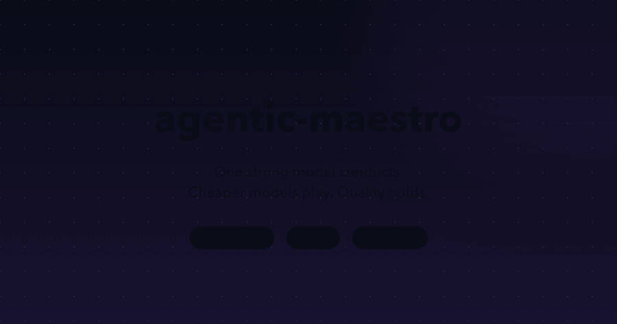
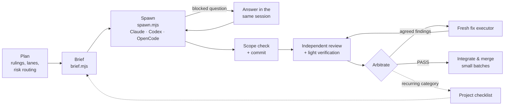
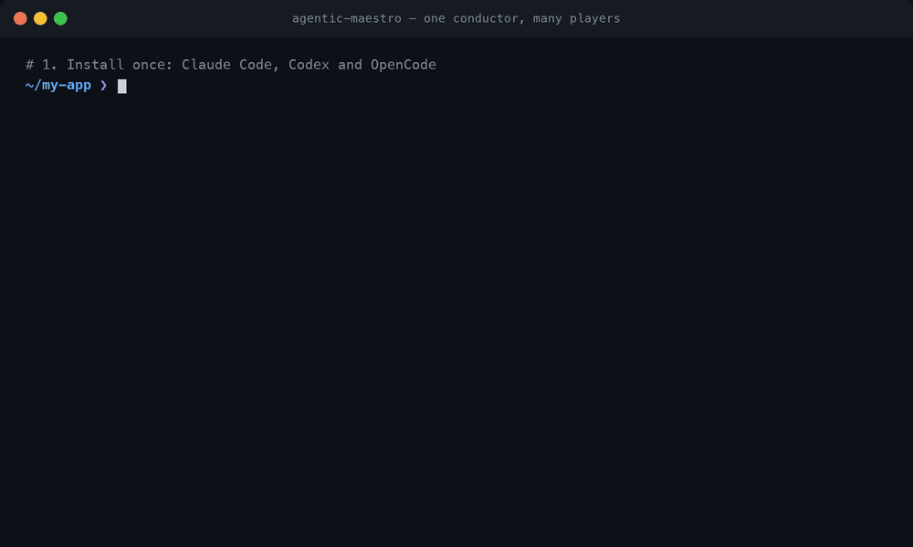

<div align="center">

[English](README.md) · **العربية** · [简体中文](README.zh-CN.md)

# agentic-maestro

**نموذج قوي يقود. نماذج أرخص تعزف. والجودة تبقى.**

</div>

<div dir="rtl">

مهارة وكيل ([Agent Skill](https://agentskills.io)) للتفويض المنظَّم: نموذج قوي يخطط ويحكم ويفصل في
الخلافات ويدمج؛ ووكلاء فرعيون أرخص ينفذون موجزات دقيقة؛ ومراجع مستقل يفحص كل نتيجة — على
**Claude Code** و**Codex** و**OpenCode**.

</div>

<div align="center">

[](LICENSE)




</div>

---

<div dir="rtl">

## لماذا

تسليم العمل إلى وكيل فرعي أمر سهل. أما تسليمه **بتكلفة منخفضة دون خسارة الجودة** فليس كذلك: المنفذون
يستكشفون المستودع كله، ويعيدون قراءة الوثائق نفسها، ويخمّنون قرارات التصميم، ويدورون في حلقات من
الأخطاء، ثم يعودون بسجل محادثة طويل بدل إجابة. ثم يدفع المنسِّق مرة أخرى ليقرأه.

يحوّل agentic-maestro التفويض إلى مسار عمل قابل للتكرار:

- **موجزات بدل السياق الكامل.** يحصل المنفذ على قرارات دقيقة، وقائمة «ماذا يعني الإنجاز»، ونمط واحد
  ينسخه (مع مقتطفات)، والأعراف التي تنطبق فقط (مقتبسة حرفيًا)، ومؤشر إلى خريطة الشيفرة، وقائمة فحص قبل
  المراجعة — لا وثائق المشروع كلها.
- **أدوات تفشل بأمان.** يرفض مُجمِّع الموجزات أي قيمة مفقودة، أو مقتطف أو كلمة مفتاحية لا تطابق شيئًا،
  أو منطقة فحص غير معروفة، فلا يتلقى المنفذ موجزًا ناقصًا بصمت.
- **مراجع مستقل** (من عائلة نماذج مختلفة) على كل commit، مع تحكيم: كل ملاحظة إما تُقبل مع قرار إصلاح
  دقيق، أو تُرفض مع سبب — ولا تُمرَّر خامًا أبدًا.
- **منفذ جديد في كل جولة إصلاح**، وقرار بنيوي بعد ثلاث جولات على المكوّن نفسه، وقائمة فحص تتعلم من
  الملاحظات المتكررة للمراجع.
- **مُشغِّل واحد لكل الأدوات**، يسجل لكل تشغيل معرّف الجلسة ورمز الخروج والرموز (tokens) والتكلفة.

### ما تم قياسه

ملاحظات ميدانية من مستودع TypeScript أحادي كبير (منسِّق قوي، ومنفذ منخفض التكلفة، وCodex مراجعًا) —
وليست معيارًا قياسيًا:

| | قبل | مع agentic-maestro |
|---|---|---|
| الرموز التي يعيد المنفذون قراءتها | خط الأساس | **−65–70%** |
| زمن بناء الميزة | خط الأساس | **~النصف** |
| جولة الإصلاح | ~300 خطوة / 74 دقيقة | **64–150 خطوة / 10–25 دقيقة** |
| رد من سطر واحد عبر `claude -p` (Haiku) | 61 ألف رمز، 0.15$، 29 ث | **0.06$، 7 ث** (الوضع الخفيف) |

## كيف يعمل

</div>



<div dir="rtl">

المنسِّق لا يكتب شيفرة الميزات أبدًا ولا يمرر ملاحظات المراجعة خامًا؛ والمنفذون لا يقررون مسائل التصميم
أبدًا. راجع [SKILL.md](SKILL.md) للدليل الكامل.

## التثبيت

المتطلبات: `git`، و`bash` (3.2 أو أحدث)، وNode.js 18 أو أحدث للسكربتات، وواحد على الأقل من الوكلاء أدناه.

</div>

```bash
git clone https://github.com/Akramovic1/agentic-maestro.git ~/agentic-maestro
cd ~/agentic-maestro
./install.sh
```

<div dir="rtl">

تشغيل `./install.sh` دون خيارات يربط المهارة في `~/.claude/skills/` (Claude Code) و`~/.agents/skills/`
(Codex وOpenCode وغيرها من مضيفي Agent Skills)، وهذا يغطي الوكلاء الثلاثة. الروابط تتبع `git pull`،
فالتحديث هو `git pull` فقط. ولا يستبدل السكربت أبدًا أي شيء ليس هذه المهارة.

| الخيار | يثبّت في | لـ |
|---|---|---|
| `--claude` | `~/.claude/skills/agentic-maestro` | Claude Code (ويقرؤه OpenCode أيضًا) |
| `--agents` | `~/.agents/skills/agentic-maestro` | Codex وOpenCode وغيرها |
| `--opencode` | `~/.config/opencode/skills/agentic-maestro` | OpenCode فقط |
| `--agent-def` | `~/.claude/agents/maestro-executor.md` | تعريف وكيل فرعي منفذ لـ Claude Code |
| `--copy` | — | نسخ بدل الرابط الرمزي |
| `--uninstall` | — | إزالة ما تم تثبيته |

### Claude Code

</div>

```bash
./install.sh --claude --agent-def
```

<div dir="rtl">

- عام: `~/.claude/skills/agentic-maestro/`. لكل مشروع: `.claude/skills/agentic-maestro/` (أضفه إلى
  المستودع لمشاركته مع فريقك).
- يختار Claude Code المهارة تلقائيًا عند تفويض العمل؛ ويمكن استدعاؤها صراحةً بـ `/agentic-maestro`.
- يضيف `--agent-def` وكيلًا فرعيًا `maestro-executor` (Sonnet، جهد عالٍ، دون MCP) لأداة Agent. عدّل
  `model` و`effort` في `~/.claude/agents/maestro-executor.md`، أو انسخه لكل فئة مخاطر.

### Codex

</div>

```bash
./install.sh --agents
```

<div dir="rtl">

- عام: `~/.agents/skills/agentic-maestro/`. لكل مستودع: `.agents/skills/agentic-maestro/` في جذر
  المستودع (يبحث Codex من مجلد العمل صعودًا حتى الجذر).
- استدعِها بـ `$agentic-maestro` أو `/skills`؛ ويختارها Codex أيضًا من وصفها.
- أعد تشغيل Codex إذا لم تظهر المهارة.

### OpenCode

</div>

```bash
./install.sh --agents          # أو --opencode لتثبيت خاص بـ OpenCode
```

<div dir="rtl">

- يكتشف OpenCode المهارات في `~/.config/opencode/skills/` و`~/.claude/skills/` و`~/.agents/skills/`
  (وأيضًا مجلدات `.opencode/` و`.claude/` و`.agents/` داخل المشروع)، فأي من التثبيتات أعلاه يعمل.
- يحمّلها الوكيل عبر أداة `skill`. إن كنت تقيّد المهارات فاسمح بها في `opencode.json`:
  `"permission": { "skill": { "agentic-maestro": "allow" } }`.
- يعمل مع OpenCode الإصدار 1 والإصدار 2. احتفظ بتثبيت واحد فقط لـ OpenCode في `PATH`؛ فالإصدار القديم
  لا يستطيع قراءة قاعدة بيانات رحّلها الإصدار 2.

### أي مضيف آخر لـ Agent Skills

تتبع المهارة صيغة [Agent Skills](https://agentskills.io) المفتوحة (`SKILL.md` بحقلي `name` و`description`،
مع `scripts/` و`references/` و`templates/`). انسخ المجلد أو اربطه في مجلد المهارات لدى المضيف؛ ومعظمهم
يقرأ `~/.agents/skills/` أيضًا.

### التحقق

</div>

```bash
ls -l ~/.claude/skills/agentic-maestro ~/.agents/skills/agentic-maestro
node ~/agentic-maestro/scripts/spawn.mjs --harness codex --brief README.md --dir . --out /tmp/x --dry-run
```

<div dir="rtl">

## البدء السريع

</div>

<p align="center"></p>

<div dir="rtl">

1. **خطِّط** بقرارات لا بنثر. قسّم العمل إلى مسارات يملك كل منها ملفاته.
2. **اكتب مواصفة** (انظر [`templates/brief-spec.example.json`](templates/brief-spec.example.json)) واجمع
   الموجز:

</div>

```bash
node scripts/brief.mjs F12.json --out .agent-briefs/F12-build-r1.md
```

<div dir="rtl">

3. **شغّل** منفذًا في شجرة عمل (worktree) خاصة به، على أي أداة:

</div>

```bash
node scripts/spawn.mjs --harness codex    --effort high --brief .agent-briefs/F12-build-r1.md --dir ../wt-F12 --out .agent-runs/F12-build-r1
node scripts/spawn.mjs --harness opencode --model opencode/deepseek-v4.1-flash-free --brief ... --dir ../wt-F13 --out ...
node scripts/spawn.mjs --harness claude   --model sonnet --effort high --brief ... --dir ../wt-F14 --out ...
```

<div dir="rtl">

   في Claude Code يمكنك أيضًا استخدام أداة Agent مع تعريف `maestro-executor` — راجع
   [references/harnesses.md](references/harnesses.md).

4. **افحص النطاق ثم commit ثم راجع**: `scripts/scope-check.sh ../wt-F12 <base-sha> 'packages/export/*'`،
   ثم مراجع مستقل في وضع القراءة فقط؛ وإعادة المراجعة تستأنف جلسة المراجع نفسها (`--resume <sessionId>`).
5. **احكم، وأصلح بمنفذ جديد، وادمج على دفعات صغيرة.** تتبّع التكلفة في السجل
   (`--ledger docs/agent-ledger.tsv`).

## المحتويات

| المسار | الغرض |
|---|---|
| [`SKILL.md`](SKILL.md) | الدليل: متى تفوّض، وكتابة الموجزات، وتشغيل المسار |
| [`references/harnesses.md`](references/harnesses.md) | أوامر التشغيل لكل أداة (Agent، `claude -p`، `codex exec`، `opencode run`)، والاستئناف، والصلاحيات |
| [`references/checklist.md`](references/checklist.md) | قائمة الفحص الافتراضية قبل المراجعة وكيف ينمّي المشروع قائمته |
| [`references/operations.md`](references/operations.md) | التزامن، وملكية المسارات، وgit، وتوجيه المراجع، والسياق، وسجل التكلفة |
| [`templates/`](templates/) | موجزات البناء والإصلاح والدمج، وكتلة القواعد المشتركة، وتعريف وكيل لـ Claude Code، ومثال مواصفة |
| [`scripts/brief.mjs`](scripts/brief.mjs) | يجمع موجزًا من مواصفة JSON؛ ويرفض عند أي نقص |
| [`scripts/spawn.mjs`](scripts/spawn.mjs) | يشغّل وكيلًا واحدًا دون واجهة على `claude` أو `codex` أو `opencode`؛ ويكتب `result.json` وسطرًا في السجل |
| [`scripts/scope-check.sh`](scripts/scope-check.sh) | يسرد الملفات المتغيرة خارج خريطة الموجز |
| [`scripts/codemap.mjs`](scripts/codemap.mjs) | يولّد `docs/CODEMAP.md` لمساحات JS/TS، أو `--generic` لأي مستودع git |
| [`scripts/excerpt.sh`](scripts/excerpt.sh)، [`scripts/conv.sh`](scripts/conv.sh) | مقتطف نمط؛ وبنود الأعراف المطابقة حرفيًا |
| [`scripts/gate.sh`](scripts/gate.sh) | قفل على مستوى الجهاز كي لا تتجاوز الفحوص الثقيلة المتزامنة عددًا محددًا |
| [`install.sh`](install.sh) | التثبيت لـ Claude Code وCodex وOpenCode |

### لمحة عن spawn.mjs

| | Claude Code | Codex | OpenCode |
|---|---|---|---|
| وضع الكتابة | `--permission-mode auto` | `--sandbox workspace-write` | `--agent build --auto` |
| القراءة فقط (مراجعة، استكشاف) | `--permission-mode plan` | `--sandbox read-only` | `--agent plan` |
| الجهد | `--effort` | `model_reasoning_effort` | `#variant` (v2) / `--variant` (v1) |
| استئناف جلسة | `--resume <id>` | `exec resume <id>` | `--session <id>` |
| خفيف افتراضيًا | دون MCP ودون مهارات | — | دون موجّه أو مهارات `~/.claude` |
| ما يُسجَّل | الجلسة، الرموز، التكلفة | الجلسة، الرموز | الجلسة |

يكتب كل تشغيل `command.txt` و`events.jsonl` و`stderr.log` و`final.md` و`result.json`؛ ورمز الخروج هو رمز
الأداة نفسها (124 انتهاء المهلة، 127 الأداة غير موجودة، 3 لا تقرير).

## التوافق

اختُبر على macOS (Bash 3.2، Node 24) مع Claude Code 2.1 وCodex CLI 0.160 وOpenCode 2.0 (وسطر أوامر
الإصدار 1)؛ واختُبرت سكربتات الطرفية أيضًا على Linux (`debian:bookworm-slim`).

## المساهمة

البلاغات وطلبات الدمج مرحَّب بها. أثمن المساهمات هي القواعد النابعة من ملاحظات مراجعة حقيقية: صِف
الملاحظة المتكررة، والقاعدة العامة، وكيف كانت ستُكتشف. أبقِ `SKILL.md` موجزًا — التفاصيل مكانها
`references/`.

## الترخيص

[MIT](LICENSE) © Ahmed Akram

</div>
