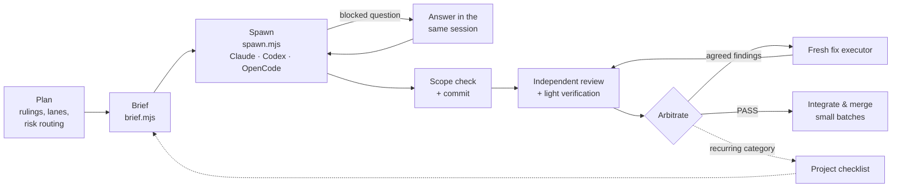

<div align="center">

**English** · [العربية](README.ar.md) · [简体中文](README.zh-CN.md)

# agentic-maestro

**One strong model conducts. Cheaper models play. Quality holds.**

An [Agent Skill](https://agentskills.io) for orchestrated delegation: a strong model plans, rules,
arbitrates and merges; cheaper sub-agents execute precise briefs; an independent reviewer checks
every result — on **Claude Code**, **Codex** and **OpenCode**.

[](LICENSE)


<picture>
  <source srcset="assets/promo.webp" type="image/webp">
  
</picture>

<sub><a href="assets/promo.mp4">Watch in HD (MP4)</a></sub>

</div>

---

## Why

Handing work to a sub-agent is easy. Handing it over **cheaply without losing quality** is not:
executors explore the whole repo, re-read the same docs, guess at design decisions, loop on errors,
and come back with a transcript instead of an answer. The orchestrator then pays again to read it.

agentic-maestro turns delegation into a repeatable pipeline:

- **Briefs instead of context.** Executors get exact rulings, a "done means" list, one pattern to copy
  (with excerpts), only the conventions that apply (quoted), a code-map pointer and a pre-review
  checklist — not the project docs.
- **Fail-closed tooling.** The brief assembler refuses a missing value, an excerpt or convention
  keyword that matches nothing, or an unknown checklist area, so an executor is never silently
  under-briefed.
- **An independent reviewer** (a different model family) on every commit, with arbitration: each
  finding is agreed with an exact fix ruling, or rejected with a reason — never forwarded raw.
- **Fresh executors per fix round**, a structural ruling after three rounds on the same component,
  and a checklist that learns from the reviewer's recurring findings.
- **One launcher for every harness**, with session ids, exit codes, tokens and cost recorded per run.

### Measured

Observed on one large TypeScript monorepo (a strong orchestrator, a low-cost executor, Codex as
reviewer) — field notes, not a benchmark:

| | Before | With agentic-maestro |
|---|---|---|
| Tokens re-read by executors | baseline | **−65–70%** |
| Build time per feature | baseline | **~½** |
| Fix round | ~300 steps / 74 min | **64–150 steps / 10–25 min** |
| Headless `claude -p` one-line reply (Haiku) | 61K tokens, $0.15, 29 s | **$0.06, 7 s** (lean mode) |

## How it works



The orchestrator never writes feature code and never forwards raw findings; executors never decide
design questions. See [SKILL.md](SKILL.md) for the full playbook.

## Install

Requirements: `git`, `bash` (3.2+), Node.js 18+ for the scripts, and at least one of the agents below.

**Fastest:** one command, via the open [skills CLI](https://skills.sh) (detects Claude Code, Codex, OpenCode and other agents):

```bash
npx skills add Akramovic1/agentic-maestro
```

**Or clone and link** (follows `git pull` for updates):

```bash
git clone https://github.com/Akramovic1/agentic-maestro.git ~/agentic-maestro
cd ~/agentic-maestro
./install.sh
```

`./install.sh` with no flags links the skill into `~/.claude/skills/` (Claude Code) and
`~/.agents/skills/` (Codex, OpenCode and other Agent Skills hosts), which covers all three agents.
Links follow `git pull`, so updating is just `git pull`. The script never overwrites anything that
is not this skill.

| Flag | Installs to | For |
|---|---|---|
| `--claude` | `~/.claude/skills/agentic-maestro` | Claude Code (OpenCode reads it too) |
| `--agents` | `~/.agents/skills/agentic-maestro` | Codex, OpenCode, other Agent Skills hosts |
| `--opencode` | `~/.config/opencode/skills/agentic-maestro` | OpenCode only |
| `--agent-def` | `~/.claude/agents/maestro-executor.md` | Claude Code executor sub-agent definition |
| `--copy` | — | Copy instead of symlink |
| `--uninstall` | — | Remove what was installed |

### Claude Code

```bash
./install.sh --claude --agent-def
```

- Global: `~/.claude/skills/agentic-maestro/`. Per project: `.claude/skills/agentic-maestro/`
  (commit it to share the skill with your team).
- Claude Code picks the skill up automatically when you delegate work; invoke it explicitly with
  `/agentic-maestro`.
- `--agent-def` adds a `maestro-executor` sub-agent (Sonnet, high effort, no MCP) for the Agent tool.
  Edit `model`/`effort` in `~/.claude/agents/maestro-executor.md`, or copy it per risk class.

### Codex

```bash
./install.sh --agents
```

- Global: `~/.agents/skills/agentic-maestro/`. Per repository: `.agents/skills/agentic-maestro/`
  at the repo root (Codex scans from the working directory up to the root).
- Invoke with `$agentic-maestro` or `/skills`; Codex also selects it from the description.
- Restart Codex if the skill does not appear.

### OpenCode

```bash
./install.sh --agents          # or --opencode for an OpenCode-only install
```

- OpenCode discovers skills in `~/.config/opencode/skills/`, `~/.claude/skills/` and
  `~/.agents/skills/` (plus the `.opencode/`, `.claude/` and `.agents/` folders of a project), so
  any of the installs above works.
- The agent loads it through its `skill` tool. Allow it in `opencode.json` if you restrict skills:
  `"permission": { "skill": { "agentic-maestro": "allow" } }`.
- Works with OpenCode v1 and v2. Keep a single OpenCode install on your `PATH`; an old binary
  cannot read a database migrated by v2.

### Any other Agent Skills host

The skill follows the open [Agent Skills](https://agentskills.io) format (`SKILL.md` with `name` and
`description`, plus `scripts/`, `references/` and `templates/`). Copy or link the folder into the
host's skills directory; most also read `~/.agents/skills/`.

### Verify

```bash
ls -l ~/.claude/skills/agentic-maestro ~/.agents/skills/agentic-maestro
node ~/agentic-maestro/scripts/spawn.mjs --harness codex --brief README.md --dir . --out /tmp/x --dry-run
```

## Quick start

<p align="center"></p>

1. **Plan** with rulings, not prose. Split the work into lanes that own their files.
2. **Write a spec** (see [`templates/brief-spec.example.json`](templates/brief-spec.example.json)) and
   assemble the brief:

   ```bash
   node scripts/brief.mjs F12.json --out .agent-briefs/F12-build-r1.md
   ```

3. **Spawn** an executor in its own worktree, on any harness:

   ```bash
   node scripts/spawn.mjs --harness codex    --effort high --brief .agent-briefs/F12-build-r1.md --dir ../wt-F12 --out .agent-runs/F12-build-r1
   node scripts/spawn.mjs --harness opencode --model opencode/deepseek-v4.1-flash-free --brief ... --dir ../wt-F13 --out ...
   node scripts/spawn.mjs --harness claude   --model sonnet --effort high --brief ... --dir ../wt-F14 --out ...
   ```

   On Claude Code you can also use the Agent tool with the `maestro-executor` definition — see
   [references/harnesses.md](references/harnesses.md).
4. **Scope-check, commit, review**: `scripts/scope-check.sh ../wt-F12 <base-sha> 'packages/export/*'`,
   then an independent reviewer in read-only mode; re-reviews resume the reviewer's own session
   (`--resume <sessionId>`).
5. **Arbitrate, fix with a fresh executor, merge small batches.** Track cost in the ledger
   (`--ledger docs/agent-ledger.tsv`).

## What's inside

| Path | Purpose |
|---|---|
| [`SKILL.md`](SKILL.md) | The playbook: when to spawn, writing briefs, running the pipeline |
| [`references/harnesses.md`](references/harnesses.md) | Spawn calls per harness (Agent tool, `claude -p`, `codex exec`, `opencode run`), resume, permissions, pitfalls |
| [`references/checklist.md`](references/checklist.md) | Default pre-review checklist and how a project grows its own |
| [`references/operations.md`](references/operations.md) | Concurrency, lane ownership, git, reviewer prompts, context hygiene, cost ledger |
| [`templates/`](templates/) | Build, fix and integration briefs; the shared rules block; a Claude Code agent definition; an example spec |
| [`scripts/brief.mjs`](scripts/brief.mjs) | Assembles a brief from a JSON spec; fails closed on any gap |
| [`scripts/spawn.mjs`](scripts/spawn.mjs) | Runs one headless agent on `claude`, `codex` or `opencode`; writes `result.json` and a ledger row |
| [`scripts/scope-check.sh`](scripts/scope-check.sh) | Lists changed files outside the brief's map |
| [`scripts/codemap.mjs`](scripts/codemap.mjs) | Generates `docs/CODEMAP.md` for JS/TS workspaces, or `--generic` for any git repo |
| [`scripts/excerpt.sh`](scripts/excerpt.sh), [`scripts/conv.sh`](scripts/conv.sh) | A pattern excerpt; matching convention bullets, verbatim |
| [`scripts/gate.sh`](scripts/gate.sh) | Machine-wide lock so parallel lanes never run more than N heavy checks at once |
| [`install.sh`](install.sh) | Installs for Claude Code, Codex and OpenCode |

### spawn.mjs at a glance

| | Claude Code | Codex | OpenCode |
|---|---|---|---|
| Write mode | `--permission-mode auto` | `--sandbox workspace-write` | `--agent build --auto` |
| Read-only (review, scout) | `--permission-mode plan` | `--sandbox read-only` | `--agent plan` |
| Effort | `--effort` | `model_reasoning_effort` | `#variant` (v2) / `--variant` (v1) |
| Resume a session | `--resume <id>` | `exec resume <id>` | `--session <id>` |
| Lean by default | no MCP, no skills | — | no `~/.claude` prompt/skills |
| Recorded | session, tokens, cost | session, tokens | session |

Every run writes `command.txt`, `events.jsonl`, `stderr.log`, `final.md` and `result.json`; the exit
code is the CLI's own (124 timeout, 127 missing CLI, 3 no report).

## Compatibility

Tested on macOS (Bash 3.2, Node 24) with Claude Code 2.1, Codex CLI 0.160 and OpenCode 2.0 (and the
v1 command line); the shell scripts were also exercised on Linux (`debian:bookworm-slim`).

## Contributing

Issues and pull requests are welcome. Rules that came from real review findings are the most valuable
contributions: describe the recurring finding, the general rule, and how it would have been caught.
Keep `SKILL.md` lean — detail belongs in `references/`.

## License

[MIT](LICENSE) © Ahmed Akram
