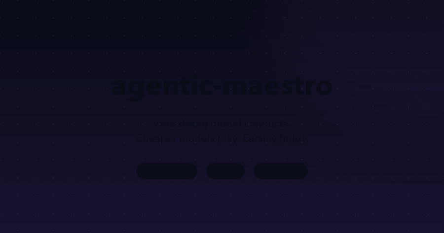
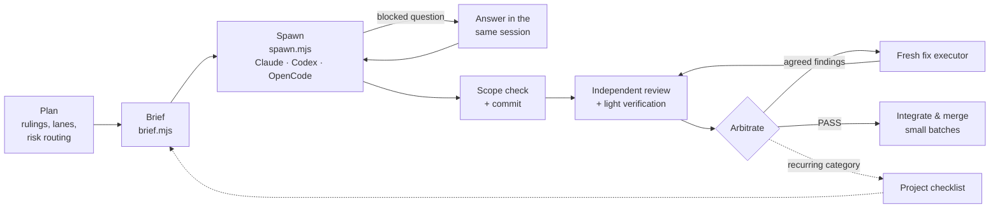
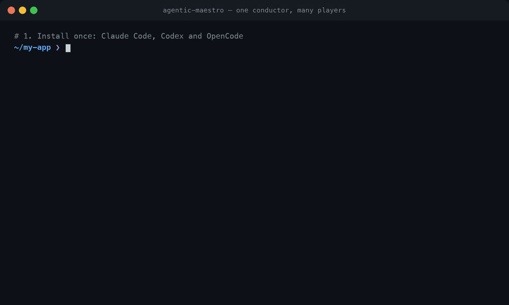

<div align="center">

[English](README.md) · [العربية](README.ar.md) · **简体中文**

# agentic-maestro

**强模型指挥，低成本模型演奏，质量不打折。**

一个用代理构建高质量代码的 [Agent Skill](https://agentskills.io)，按会话选择合适的工作模式：强模型亲自写代码、
指挥强执行者，或指挥低成本执行者；红队审查或完整审计覆盖关键代码；独立审查者检查每一个结果——支持
**Claude Code**、**Codex** 和 **OpenCode**。

[](LICENSE)


<picture>
  <source srcset="assets/promo.webp" type="image/webp">
  
</picture>

<sub><a href="assets/promo.mp4">观看高清版（MP4）</a></sub>

</div>

---

## 模式

模式决定谁写代码、谁审查，以及按什么顺序执行哪些任务。在请求里直接说出模式（"frontier：实现导出功能"、
"audit 质押合约"）；没有指定时，maestro 会自行选择，或只问一个问题。

| 模式 | 谁写代码 | 适用场景 |
|---|---|---|
| `direct` | 强模型自己 | 强模型额度充足、只有一条车道，或需要判断力的工作 |
| `frontier` | 强执行者，由强模型指挥 | 可拆成并行车道的普通代码 |
| `critical` | 只用强执行者 | 重要 API 与智能合约：对方案和提交各做一次红队审查，必须有属性测试 |
| `economy` | 低成本执行者（DeepSeek、GLM 等） | 在有精确裁定的工作上节省强模型额度 |
| `reserve` | 低成本执行者，由当前可用的最好模型指挥 | 强模型额度已用完 |
| `redteam` | 无（只读） | 对单个方案或单个提交做安全检查 |
| `audit` | 无（测试写在临时副本里） | 对合约系统或关键 API 做完整安全审计 |
| `harden` | 强模型，清理工作交给低成本执行者 | 把反复出现的审查发现变成 lint 规则、类型和测试 |

所有模式共用同一条底线：先裁定后写代码、测试即证据、在真实运行的产物上验证、由不同模型家族的独立审查者
审查、每一次重复的纠正都变成自动运行的检查。普通代码不做过度防护：安全审查只用于转移资金、授予权限或
链上运行的代码。

所有模式都定义在一个 JSON 文件里：每个角色用哪个模型、要读哪些文件、任务顺序和规则。复制一份按需修改：

```bash
node scripts/mode.mjs list            # 当前生效的模式及其模型阵容
node scripts/mode.mjs init --user     # 复制到 ~/.config/agentic-maestro/modes.json 后编辑
node scripts/mode.mjs check           # 拒绝未知的角色或模型，以及与写代码者同一家族的审查者
```

`audit` 和 `critical` 可以借助你已安装的专业技能（例如 Trail of Bits 和 Pashov Audit Group 发布的审计技能）：
模式里写明名称，maestro 加载已安装的，并说明缺少哪些。详见 [references/modes.md](references/modes.md)。

## 为什么

把工作交给子代理很容易；**以低成本交出去且不损失质量**却很难：执行者会探索整个仓库、反复阅读相同的文档、
猜测设计决策、在错误中打转，最后带回一份冗长的对话记录而不是答案——编排者还要再付一次成本去读它。

agentic-maestro 把委派变成一条可重复的流水线：

- **用简报代替上下文。** 执行者拿到的是精确的裁定（rulings）、"完成标准"清单、一个可照抄的范式（附代码摘录）、
  只与本任务相关的约定（逐字引用）、代码地图指引和审查前自检清单——而不是整个项目文档。
- **失败即关闭（fail-closed）的工具。** 简报组装器在缺少取值、摘录或约定关键词匹配不到任何内容、或检查项
  区域不存在时直接拒绝，执行者绝不会在不知情的情况下拿到残缺的简报。
- **独立审查者**（不同模型家族）审查每一次提交，并经过仲裁：每条发现要么附上精确的修复裁定后接受，
  要么说明理由后驳回——绝不原样转发。
- **每轮修复都用全新的执行者**；同一组件连续三轮出问题时改为结构性裁定；检查清单会从审查者反复出现的
  发现中学习。
- **一个启动器适配所有工具**，每次运行都记录会话 ID、退出码、token 用量与成本。

### 实测数据

来自一个大型 TypeScript monorepo 的现场记录（强编排者 + 低成本执行者 + Codex 作为审查者）——并非基准测试：

| | 之前 | 使用 agentic-maestro |
|---|---|---|
| 执行者重复读取的 token | 基线 | **−65–70%** |
| 每个功能的构建时间 | 基线 | **约减半** |
| 一轮修复 | 约 300 步 / 74 分钟 | **64–150 步 / 10–25 分钟** |
| 无头模式 `claude -p` 单行回复（Haiku） | 6.1 万 token、$0.15、29 秒 | **$0.06、7 秒**（精简模式） |

## 工作原理



这是委派流水线（`frontier`、`critical`、`economy`、`reserve`）：maestro 不写功能代码，也不原样转发审查发现；
执行者不做设计决策。在 `direct` 模式下，maestro 在同一条底线上亲自写代码。[SKILL.md](SKILL.md) 负责选择模式，
各模式的手册在 [`references/`](references/) 中。

## 安装

依赖：`git`、`bash`（3.2+）、运行脚本所需的 Node.js 18+，以及下列至少一种代理工具。

**最快：** 通过开放的 [skills CLI](https://skills.sh) 一条命令安装（自动识别 Claude Code、Codex、OpenCode 等代理）：

```bash
npx skills add Akramovic1/agentic-maestro
```

**或克隆并链接**（随 `git pull` 更新）：

```bash
git clone https://github.com/Akramovic1/agentic-maestro.git ~/agentic-maestro
cd ~/agentic-maestro
./install.sh
```

不带参数运行 `./install.sh` 会把技能链接到 `~/.claude/skills/`（Claude Code）和 `~/.agents/skills/`
（Codex、OpenCode 及其他 Agent Skills 宿主），三种代理全部覆盖。链接会随 `git pull` 更新，所以升级只需
`git pull`。脚本永远不会覆盖不属于本技能的内容。

| 参数 | 安装位置 | 适用于 |
|---|---|---|
| `--claude` | `~/.claude/skills/agentic-maestro` | Claude Code（OpenCode 也会读取） |
| `--agents` | `~/.agents/skills/agentic-maestro` | Codex、OpenCode 及其他 Agent Skills 宿主 |
| `--opencode` | `~/.config/opencode/skills/agentic-maestro` | 仅 OpenCode |
| `--agent-def` | `~/.claude/agents/maestro-executor.md` | Claude Code 执行者子代理定义 |
| `--copy` | — | 复制而不是符号链接 |
| `--uninstall` | — | 移除已安装的内容 |

### Claude Code

```bash
./install.sh --claude --agent-def
```

- 全局：`~/.claude/skills/agentic-maestro/`。按项目：`.claude/skills/agentic-maestro/`（提交到仓库即可与团队共享）。
- 委派工作时 Claude Code 会自动选用该技能；也可以用 `/agentic-maestro` 显式调用。
- `--agent-def` 会为 Agent 工具添加 `maestro-executor` 子代理（Sonnet、高推理强度、不加载 MCP）。
  可在 `~/.claude/agents/maestro-executor.md` 中修改 `model`/`effort`，或按风险等级复制多份。

### Codex

```bash
./install.sh --agents
```

- 全局：`~/.agents/skills/agentic-maestro/`。按仓库：仓库根目录下的 `.agents/skills/agentic-maestro/`
  （Codex 会从当前目录向上扫描到仓库根目录）。
- 用 `$agentic-maestro` 或 `/skills` 调用；Codex 也会根据描述自动选用。
- 如果技能没有出现，请重启 Codex。

### OpenCode

```bash
./install.sh --agents          # 或使用 --opencode 仅为 OpenCode 安装
```

- OpenCode 会在 `~/.config/opencode/skills/`、`~/.claude/skills/` 和 `~/.agents/skills/`
  （以及项目中的 `.opencode/`、`.claude/`、`.agents/` 目录）中发现技能，以上任意一种安装方式都可用。
- 代理通过 `skill` 工具加载它。如果你限制了技能权限，请在 `opencode.json` 中放行：
  `"permission": { "skill": { "agentic-maestro": "allow" } }`。
- 同时支持 OpenCode v1 和 v2。`PATH` 中请只保留一个 OpenCode 安装；旧版二进制无法读取已被 v2 迁移的数据库。

### 其他 Agent Skills 宿主

本技能遵循开放的 [Agent Skills](https://agentskills.io) 格式（带 `name` 和 `description` 的 `SKILL.md`，
以及 `scripts/`、`references/`、`templates/`）。把目录复制或链接到宿主的技能目录即可；大多数宿主也会读取
`~/.agents/skills/`。

### 验证

```bash
ls -l ~/.claude/skills/agentic-maestro ~/.agents/skills/agentic-maestro
node ~/agentic-maestro/scripts/spawn.mjs --harness codex --brief README.md --dir . --out /tmp/x --dry-run
```

## 快速上手

<p align="center"></p>

在请求中说出模式，代理就会按该模式的任务清单执行。手动操作时，委派模式的流程如下：

1. **用裁定而不是描述来规划。** 把工作拆成若干条各自拥有文件的"车道"（lane）。
2. **编写规格**（见 [`templates/brief-spec.example.json`](templates/brief-spec.example.json)）并组装简报：

   ```bash
   node scripts/brief.mjs F12.json --out .agent-briefs/F12-build-r1.md
   ```

3. **启动**执行者，各自运行在独立的 worktree 中，任意工具均可：

   ```bash
   node scripts/spawn.mjs --harness codex    --effort high --brief .agent-briefs/F12-build-r1.md --dir ../wt-F12 --out .agent-runs/F12-build-r1
   node scripts/spawn.mjs --harness opencode --model opencode/deepseek-v4.1-flash-free --brief ... --dir ../wt-F13 --out ...
   node scripts/spawn.mjs --harness claude   --model sonnet --effort high --brief ... --dir ../wt-F14 --out ...
   ```

   在 Claude Code 中也可以配合 `maestro-executor` 定义使用 Agent 工具——见
   [references/harnesses.md](references/harnesses.md)。
4. **范围检查、提交、审查**：`scripts/scope-check.sh ../wt-F12 <base-sha> 'packages/export/*'`，
   然后以只读模式运行独立审查者；复审时恢复该审查者自己的会话（`--resume <sessionId>`）。
5. **仲裁，用全新执行者修复，小批量合并。** 用成本台账追踪开销（`--ledger docs/agent-ledger.tsv`）。

## 目录内容

| 路径 | 用途 |
|---|---|
| [`SKILL.md`](SKILL.md) | 每次会话如何选择模式、所有模式共用的规则、接下来读什么 |
| [`templates/modes.json`](templates/modes.json) | 内置模式：每个角色的模型、要读的文件、任务顺序、规则 |
| [`references/modes.md`](references/modes.md) | 模式文件的格式、你自己的副本放在哪里、常见修改 |
| [`references/direct.md`](references/direct.md) | 强模型亲自写代码：循环、修 bug／功能／重构／性能的手册、报告块 |
| [`references/delegate.md`](references/delegate.md) | 编写简报，并与执行者一起运行 构建 -> 审查 -> 修复 -> 合并 |
| [`references/redteam.md`](references/redteam.md) | 对方案或提交的只读安全检查 |
| [`references/audit.md`](references/audit.md) | 对合约系统或关键 API 的完整安全审计，共十个阶段 |
| [`references/hardening.md`](references/hardening.md) | 把审查发现和纠正变成类型、lint 规则和测试 |
| [`references/verification.md`](references/verification.md) | 在真实产物上验证：运行证据、功能地图、驱动脚本、属性测试与形式化检查 |
| [`scripts/mode.mjs`](scripts/mode.mjs) | 列出、展示并校验模式；输出某个角色的启动参数 |
| [`scripts/toolcheck.sh`](scripts/toolcheck.sh) | 列出已安装的安全分析工具，缺少的在报告中标为"未覆盖" |
| [`references/harnesses.md`](references/harnesses.md) | 各工具的启动方式（Agent 工具、`claude -p`、`codex exec`、`opencode run`）、会话恢复、权限与坑点 |
| [`references/checklist.md`](references/checklist.md) | 默认的审查前检查清单，以及项目如何积累自己的清单 |
| [`references/operations.md`](references/operations.md) | 并发、车道归属、git、审查提示词、上下文控制、成本台账 |
| [`templates/`](templates/) | 构建、修复、集成简报模板；共享规则块；Claude Code 代理定义；规格示例 |
| [`scripts/brief.mjs`](scripts/brief.mjs) | 从 JSON 规格组装简报；任何缺失都会拒绝 |
| [`scripts/spawn.mjs`](scripts/spawn.mjs) | 以无头模式在 `claude`、`codex` 或 `opencode` 上运行一个代理；写入 `result.json` 和台账记录 |
| [`scripts/runs.mjs`](scripts/runs.mjs) | 根据 `spawn.mjs` 留下的心跳显示每次运行的状态（运行中、无输出、失去启动器，或如何结束） |
| [`scripts/scope-check.sh`](scripts/scope-check.sh) | 列出超出简报文件范围的改动 |
| [`scripts/codemap.mjs`](scripts/codemap.mjs) | 为 JS/TS 工作区生成 `docs/CODEMAP.md`，或用 `--generic` 处理任意 git 仓库 |
| [`scripts/excerpt.sh`](scripts/excerpt.sh)、[`scripts/conv.sh`](scripts/conv.sh) | 范式代码摘录；逐字引用匹配的约定条目 |
| [`scripts/gate.sh`](scripts/gate.sh) | 机器级锁，确保并行车道同时运行的重型检查不超过 N 个 |
| [`install.sh`](install.sh) | 为 Claude Code、Codex 和 OpenCode 安装 |

### spawn.mjs 速览

| | Claude Code | Codex | OpenCode |
|---|---|---|---|
| 写入模式 | `--permission-mode auto` | `--sandbox workspace-write` | `--agent build --auto` |
| 只读（审查、侦察） | `--permission-mode plan` | `--sandbox read-only` | `--agent plan` |
| 推理强度 | `--effort` | `model_reasoning_effort` | `#variant`（v2）/ `--variant`（v1） |
| 恢复会话 | `--resume <id>` | `exec resume <id>` | `--session <id>` |
| 默认精简 | 不加载 MCP 与技能 | — | 不加载 `~/.claude` 提示词与技能 |
| 记录内容 | 会话、token、成本 | 会话、token | 会话 |

每次运行都会写入 `command.txt`、`events.jsonl`、`stderr.log`、`final.md` 和 `result.json`；退出码即 CLI 自身的
退出码（124 超时、127 找不到 CLI、3 没有报告）。

## 兼容性

已在 macOS（Bash 3.2、Node 24）上配合 Claude Code 2.1、Codex CLI 0.160 和 OpenCode 2.0（以及 v1 命令行）测试；
Shell 脚本也在 Linux（`debian:bookworm-slim`）上验证过。

## 参与贡献

欢迎提交 Issue 和 Pull Request。最有价值的贡献是来自真实审查发现的规则：描述反复出现的问题、对应的通用规则，
以及它本可以如何被提前发现。请保持 `SKILL.md` 精简——细节放在 `references/` 中。

## 致谢

`direct` 模式、加固阶梯以及对验证的重视，借鉴了 Lauren Tan 的演讲 "All Code Is Slop (Except Mine)" 和她的
[pstack](https://github.com/cursor/plugins/tree/main/pstack) 插件。`audit` 模式可与已安装的
[Trail of Bits](https://github.com/trailofbits/skills) 和 [Pashov Audit Group](https://github.com/pashov/skills)
技能配合使用；本仓库不包含它们的任何文本。

## 许可证

[MIT](LICENSE) © Ahmed Akram
