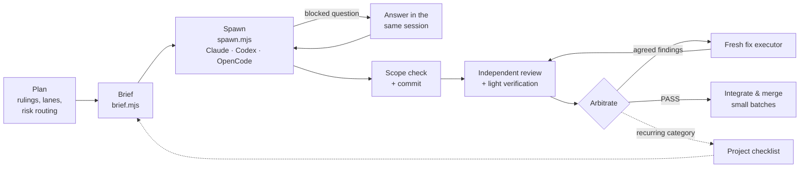

<div align="center">

[English](README.md) · [العربية](README.ar.md) · **简体中文**

# agentic-maestro

**强模型指挥，低成本模型演奏，质量不打折。**

一个用于编排式委派的 [Agent Skill](https://agentskills.io)：强模型负责规划、裁定、仲裁与合并；
低成本子代理执行精确的任务简报（brief）；独立审查者检查每一个结果——支持 **Claude Code**、**Codex**
和 **OpenCode**。

[](LICENSE)


</div>

---

## 为什么

把工作交给子代理很容易；**以低成本交出去且不损失质量**却很难：执行者会探索整个仓库、反复阅读相同的文档、
猜测设计决策、在错误中打转，最后带回一份冗长的对话记录而不是答案——编排者还要再付一次成本去读它。

agentic-maestro 把委派变成一条可重复的流水线：

- **用简报代替上下文。** 执行者拿到的是精确的裁定（rulings）、"完成标准"清单、一个可照抄的范式（附代码摘录）、
  只与本任务相关的约定（逐字引用）、代码地图指引和审查前自检清单——而不是整个项目文档。
- **失败即关闭（fail-closed）的工具。** 简报组装器在缺少取值、摘录或约定关键词匹配不到任何内容、或检查项
  区域不存在时直接拒绝，执行者绝不会在不知情的情况下拿到残缺的简报。
- **独立审查者**（不同模型家族）审查每一次提交，并经过仲裁：每条发现要么附上精确的修复裁定后接受，
  要么说明理由后驳回——绝不原样转发。
- **每轮修复都用全新的执行者**；同一组件连续三轮出问题时改为结构性裁定；检查清单会从审查者反复出现的
  发现中学习。
- **一个启动器适配所有工具**，每次运行都记录会话 ID、退出码、token 用量与成本。

### 实测数据

来自一个大型 TypeScript monorepo 的现场记录（强编排者 + 低成本执行者 + Codex 作为审查者）——并非基准测试：

| | 之前 | 使用 agentic-maestro |
|---|---|---|
| 执行者重复读取的 token | 基线 | **−65–70%** |
| 每个功能的构建时间 | 基线 | **约减半** |
| 一轮修复 | 约 300 步 / 74 分钟 | **64–150 步 / 10–25 分钟** |
| 无头模式 `claude -p` 单行回复（Haiku） | 6.1 万 token、$0.15、29 秒 | **$0.06、7 秒**（精简模式） |

## 工作原理



编排者从不编写功能代码，也从不原样转发审查发现；执行者从不做设计决策。完整手册见 [SKILL.md](SKILL.md)。

## 安装

依赖：`git`、`bash`（3.2+）、运行脚本所需的 Node.js 18+，以及下列至少一种代理工具。

```bash
git clone https://github.com/Akramovic1/agentic-maestro.git ~/agentic-maestro
cd ~/agentic-maestro
./install.sh
```

不带参数运行 `./install.sh` 会把技能链接到 `~/.claude/skills/`（Claude Code）和 `~/.agents/skills/`
（Codex、OpenCode 及其他 Agent Skills 宿主），三种代理全部覆盖。链接会随 `git pull` 更新，所以升级只需
`git pull`。脚本永远不会覆盖不属于本技能的内容。

| 参数 | 安装位置 | 适用于 |
|---|---|---|
| `--claude` | `~/.claude/skills/agentic-maestro` | Claude Code（OpenCode 也会读取） |
| `--agents` | `~/.agents/skills/agentic-maestro` | Codex、OpenCode 及其他 Agent Skills 宿主 |
| `--opencode` | `~/.config/opencode/skills/agentic-maestro` | 仅 OpenCode |
| `--agent-def` | `~/.claude/agents/maestro-executor.md` | Claude Code 执行者子代理定义 |
| `--copy` | — | 复制而不是符号链接 |
| `--uninstall` | — | 移除已安装的内容 |

### Claude Code

```bash
./install.sh --claude --agent-def
```

- 全局：`~/.claude/skills/agentic-maestro/`。按项目：`.claude/skills/agentic-maestro/`（提交到仓库即可与团队共享）。
- 委派工作时 Claude Code 会自动选用该技能；也可以用 `/agentic-maestro` 显式调用。
- `--agent-def` 会为 Agent 工具添加 `maestro-executor` 子代理（Sonnet、高推理强度、不加载 MCP）。
  可在 `~/.claude/agents/maestro-executor.md` 中修改 `model`/`effort`，或按风险等级复制多份。

### Codex

```bash
./install.sh --agents
```

- 全局：`~/.agents/skills/agentic-maestro/`。按仓库：仓库根目录下的 `.agents/skills/agentic-maestro/`
  （Codex 会从当前目录向上扫描到仓库根目录）。
- 用 `$agentic-maestro` 或 `/skills` 调用；Codex 也会根据描述自动选用。
- 如果技能没有出现，请重启 Codex。

### OpenCode

```bash
./install.sh --agents          # 或使用 --opencode 仅为 OpenCode 安装
```

- OpenCode 会在 `~/.config/opencode/skills/`、`~/.claude/skills/` 和 `~/.agents/skills/`
  （以及项目中的 `.opencode/`、`.claude/`、`.agents/` 目录）中发现技能，以上任意一种安装方式都可用。
- 代理通过 `skill` 工具加载它。如果你限制了技能权限，请在 `opencode.json` 中放行：
  `"permission": { "skill": { "agentic-maestro": "allow" } }`。
- 同时支持 OpenCode v1 和 v2。`PATH` 中请只保留一个 OpenCode 安装；旧版二进制无法读取已被 v2 迁移的数据库。

### 其他 Agent Skills 宿主

本技能遵循开放的 [Agent Skills](https://agentskills.io) 格式（带 `name` 和 `description` 的 `SKILL.md`，
以及 `scripts/`、`references/`、`templates/`）。把目录复制或链接到宿主的技能目录即可；大多数宿主也会读取
`~/.agents/skills/`。

### 验证

```bash
ls -l ~/.claude/skills/agentic-maestro ~/.agents/skills/agentic-maestro
node ~/agentic-maestro/scripts/spawn.mjs --harness codex --brief README.md --dir . --out /tmp/x --dry-run
```

## 快速上手

<p align="center"></p>

1. **用裁定而不是描述来规划。** 把工作拆成若干条各自拥有文件的"车道"（lane）。
2. **编写规格**（见 [`templates/brief-spec.example.json`](templates/brief-spec.example.json)）并组装简报：

   ```bash
   node scripts/brief.mjs F12.json --out .agent-briefs/F12-build-r1.md
   ```

3. **启动**执行者，各自运行在独立的 worktree 中，任意工具均可：

   ```bash
   node scripts/spawn.mjs --harness codex    --effort high --brief .agent-briefs/F12-build-r1.md --dir ../wt-F12 --out .agent-runs/F12-build-r1
   node scripts/spawn.mjs --harness opencode --model opencode/deepseek-v4.1-flash-free --brief ... --dir ../wt-F13 --out ...
   node scripts/spawn.mjs --harness claude   --model sonnet --effort high --brief ... --dir ../wt-F14 --out ...
   ```

   在 Claude Code 中也可以配合 `maestro-executor` 定义使用 Agent 工具——见
   [references/harnesses.md](references/harnesses.md)。
4. **范围检查、提交、审查**：`scripts/scope-check.sh ../wt-F12 <base-sha> 'packages/export/*'`，
   然后以只读模式运行独立审查者；复审时恢复该审查者自己的会话（`--resume <sessionId>`）。
5. **仲裁，用全新执行者修复，小批量合并。** 用成本台账追踪开销（`--ledger docs/agent-ledger.tsv`）。

## 目录内容

| 路径 | 用途 |
|---|---|
| [`SKILL.md`](SKILL.md) | 手册：何时委派、如何编写简报、如何运行流水线 |
| [`references/harnesses.md`](references/harnesses.md) | 各工具的启动方式（Agent 工具、`claude -p`、`codex exec`、`opencode run`）、会话恢复、权限与坑点 |
| [`references/checklist.md`](references/checklist.md) | 默认的审查前检查清单，以及项目如何积累自己的清单 |
| [`references/operations.md`](references/operations.md) | 并发、车道归属、git、审查提示词、上下文控制、成本台账 |
| [`templates/`](templates/) | 构建、修复、集成简报模板；共享规则块；Claude Code 代理定义；规格示例 |
| [`scripts/brief.mjs`](scripts/brief.mjs) | 从 JSON 规格组装简报；任何缺失都会拒绝 |
| [`scripts/spawn.mjs`](scripts/spawn.mjs) | 以无头模式在 `claude`、`codex` 或 `opencode` 上运行一个代理；写入 `result.json` 和台账记录 |
| [`scripts/scope-check.sh`](scripts/scope-check.sh) | 列出超出简报文件范围的改动 |
| [`scripts/codemap.mjs`](scripts/codemap.mjs) | 为 JS/TS 工作区生成 `docs/CODEMAP.md`，或用 `--generic` 处理任意 git 仓库 |
| [`scripts/excerpt.sh`](scripts/excerpt.sh)、[`scripts/conv.sh`](scripts/conv.sh) | 范式代码摘录；逐字引用匹配的约定条目 |
| [`scripts/gate.sh`](scripts/gate.sh) | 机器级锁，确保并行车道同时运行的重型检查不超过 N 个 |
| [`install.sh`](install.sh) | 为 Claude Code、Codex 和 OpenCode 安装 |

### spawn.mjs 速览

| | Claude Code | Codex | OpenCode |
|---|---|---|---|
| 写入模式 | `--permission-mode auto` | `--sandbox workspace-write` | `--agent build --auto` |
| 只读（审查、侦察） | `--permission-mode plan` | `--sandbox read-only` | `--agent plan` |
| 推理强度 | `--effort` | `model_reasoning_effort` | `#variant`（v2）/ `--variant`（v1） |
| 恢复会话 | `--resume <id>` | `exec resume <id>` | `--session <id>` |
| 默认精简 | 不加载 MCP 与技能 | — | 不加载 `~/.claude` 提示词与技能 |
| 记录内容 | 会话、token、成本 | 会话、token | 会话 |

每次运行都会写入 `command.txt`、`events.jsonl`、`stderr.log`、`final.md` 和 `result.json`；退出码即 CLI 自身的
退出码（124 超时、127 找不到 CLI、3 没有报告）。

## 兼容性

已在 macOS（Bash 3.2、Node 24）上配合 Claude Code 2.1、Codex CLI 0.160 和 OpenCode 2.0（以及 v1 命令行）测试；
Shell 脚本也在 Linux（`debian:bookworm-slim`）上验证过。

## 参与贡献

欢迎提交 Issue 和 Pull Request。最有价值的贡献是来自真实审查发现的规则：描述反复出现的问题、对应的通用规则，
以及它本可以如何被提前发现。请保持 `SKILL.md` 精简——细节放在 `references/` 中。

## 许可证

[MIT](LICENSE) © Ahmed Akram
